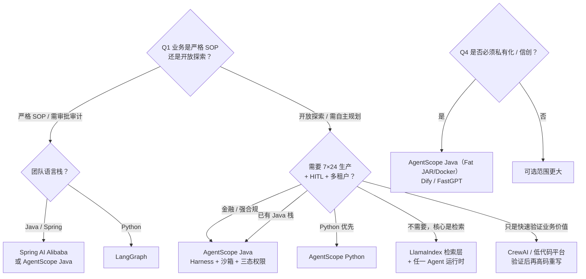

# 04 · 同类框架对比与技术选型

> **TL;DR（3 分钟版）**
> - 选型第一刀不是"功能多少"，而是**编排范式**：图编排（LangGraph/ADK）、角色协作（CrewAI/AutoGen）、轻量委派（OpenAI Agents SDK）、运行时/生产派（AgentScope、dsh、Eino）、知识密集（LlamaIndex）、低代码（Dify）。
> - **语言栈决定 80% 的答案**：Java 栈选 AgentScope Java（唯一同时具备"生产级运行时 + 官方 Harness + Spring 生态"的选择）；Python 栈按结构化程度选 LangGraph（流程型）或 AgentScope Py（自主型）。
> - **AutoGen 已进入维护模式，新项目慎选**；CrewAI 适合原型；Dify/低码适合 ≤10 步稳定流程与业务验证。
> - 架构原则：**一个运行时 + 它的原生编排，不要引入第二个运行时**；检索短板用 LlamaIndex/百炼等专业层补齐。
> - 选型前用 §6 的 8 个问题逐条核验，答不上来的就是风险。

> 目标：回答"除了 AgentScope，还有哪些可用框架？各自的定位与代价是什么？"
> **数据时点：2026-10**，来源为公开横评 + 各框架官方文档/仓库现状 + 本地源码（AgentScope 两版、dsh）；对比表中的星级为**相对判断**，下载量/Star 等为公开报道口径，会随时间变化。
> 下一篇会把结论收敛成[落地路线](06-技术选型建议与落地路线.md)。

---

## 1. 先按编排范式分派别

框架选型的第一刀不是"功能多少"，而是**编排范式**——它决定了你能表达什么、以及痛苦发生在哪里。

| 派别 | 代表 | 核心抽象 | 擅长 |
|---|---|---|---|
| **图编排派** | LangGraph、Google ADK、MS Agent Framework | 节点 + 边 + 状态机 | 流程可控、人工审批、审计、严格 SOP |
| **角色协作派** | CrewAI、AutoGen/AG2、MetaGPT | 角色 + 对话/流水线 | 角色分工、业务协作、从 PRD 到代码骨架 |
| **轻量委派派** | OpenAI Agents SDK、Pydantic AI | Agent + handoff / 类型化输出 | 小而快、与单一厂商深度集成 |
| **运行时/生产派** | **AgentScope**（Py + Java）、DeepSeek Harness、字节 Eino | ReAct 循环 + 中间件 + 事件流 + 沙箱 | 企业级 7×24、HITL、多租户、长任务 |
| **知识密集型派** | LlamaIndex、RAGFlow、FastGPT | 索引 + 检索 + 工作流 | 知识库问答、文档密集场景 |
| **低代码平台** | Dify、Coze、FastGPT | 可视化工作流 | 业务人员参与、快速原型 |

---

## 2. 主对比表（10 个框架 × 14 个维度）

> 星级为相对判断（基于公开横评与文档），⚠️ 表示需注意的代价。

| 框架 | 语言 | 范式 | 生产就绪 | 权限/安全 | HITL | 多租户 | 分布式 | 可观测 | 学习曲线 | 备注 |
|---|---|---|---|---|---|---|---|---|---|---|
| **AgentScope 2.x (Py)** | Python | ReAct + 中间件 + 事件流 | ⭐⭐⭐⭐⭐ | ⭐⭐⭐⭐（5 模式 + 敏感路径） | ⭐⭐⭐⭐⭐（停泊-恢复） | ⭐⭐⭐（服务端 app） | ⭐⭐⭐⭐ | ⭐⭐⭐⭐（OTel） | 中 | 异步-only，无同步 API |
| **AgentScope Java** | Java 17 | ReAct + Harness 运行时 | ⭐⭐⭐⭐⭐ | ⭐⭐⭐⭐⭐（三态权限 + 沙箱矩阵） | ⭐⭐⭐⭐⭐ | ⭐⭐⭐⭐⭐（显式无状态） | ⭐⭐⭐⭐⭐（四平面 + 分布式存储） | ⭐⭐⭐⭐⭐ | 中高 | **RAG / 长期记忆 v2 仍在推进**（选型要点） |
| **LangGraph** | Python/TS | 图/状态机 | ⭐⭐⭐（需自行部署） | ⭐⭐（基础） | ⭐⭐⭐（节点级中断） | ⭐⭐（自建） | ⭐⭐（靠自己） | ⭐⭐⭐（LangSmith 需配） | **陡** | 生态最大（公开数据月下载 34.5M），但分布式与多租户要自己补 |
| **AutoGen / AG2** | Python | 对话驱动 GroupChat | ⭐⭐ | ⭐ | ⭐⭐ | ⭐ | ⭐ | ⭐⭐ | 中 | ⚠️ **已进入维护模式（2025 末）**，新项目慎选 |
| **CrewAI** | Python | 角色扮演 | ⭐⭐ | ⭐ | ⭐⭐ | ⭐ | ⭐ | ⭐ | **低** | 快速原型首选，生产保障弱 |
| **MetaGPT** | Python | SOP 流水线 | ⭐⭐ | ⭐ | ⭐ | ⭐ | ⭐ | ⭐⭐ | 中 | 高结构化场景（"从 PRD 到代码骨架"） |
| **OpenAI Agents SDK** | Python/TS | Agent + handoff | ⭐⭐⭐ | ⭐⭐ | ⭐⭐ | ⭐⭐ | ⭐⭐ | ⭐⭐ | **低** | 与 OpenAI 深度绑定，跨厂商弱 |
| **Google ADK** | Python/Java | 图/工作流 | ⭐⭐⭐ | ⭐⭐ | ⭐⭐ | ⭐⭐ | ⭐⭐⭐ | ⭐⭐⭐ | 中 | 与 Gemini/Vertex 绑定 |
| **Spring AI Alibaba** | Java | Spring 生态 Agent | ⭐⭐⭐ | ⭐⭐⭐ | ⭐⭐ | ⭐⭐ | ⭐⭐⭐ | ⭐⭐⭐ | 中 | **Spring 团队首选**；与 AgentScope Java 可共存（后者有 13 个 starter） |
| **LlamaIndex** | Python/TS | 索引 + 工作流 | ⭐⭐⭐ | ⭐⭐ | ⭐⭐ | ⭐⭐ | ⭐⭐ | ⭐⭐⭐ | 中 | **RAG 最强**，Agent 编排非所长 |
| **Dify / FastGPT** | 低代码 | 可视化工作流 | ⭐⭐⭐（平台自带） | ⭐⭐⭐ | ⭐⭐⭐ | ⭐⭐⭐ | ⭐⭐⭐ | ⭐⭐⭐ | **低** | 5~10 步内的稳定流程合适；复杂编排与跨会话状态会失控 |

---

## 3. 逐框架要点与坑

### 3.1 LangGraph —— 生态最大，代价是"生产化要自己补"

- **优势**：节点/边/状态机模型心智清晰，最适合"流程必须严格可控 + 人工审批 + 审计"的场景；生态集成数量最多。
- **代价**：学习曲线陡；多租户、分布式、权限、沙箱都需要自建或外接；LangChain 依赖（`langchain-core` 是必需依赖）。
- **选它的信号**：你的业务本质是**有明确 SOP 的流程**，而不是开放探索。

### 3.2 AutoGen / AG2 —— 维护模式，慎选

- 对话驱动的 GroupChat 适合研究、辩论、代码生成类实验。
- ⚠️ 2025 末已进入维护模式，新项目不建议起在它上面；已有项目建议评估迁移到 LangGraph 或 AgentScope。

### 3.3 CrewAI —— 原型最快，生产最弱

- 角色扮演范式，开发效率高，学习曲线最低。
- 权限、沙箱、多租户、分布式基本没有；适合**快速验证业务价值**，不适合直接上生产。

### 3.4 OpenAI Agents SDK —— 轻，但绑得深

- handoff 模型简洁，与 OpenAI 生态（Responses API、内置工具）深度集成。
- 跨厂商能力与生产级保障弱；如果确定只用 OpenAI，它是性价比最高的选择。

### 3.5 Spring AI Alibaba —— Java 团队的"顺手"选择

- 与 Spring 生态（Boot 3/4、Nacos、ARMS）无缝；Graph 编排 + 多智能体。
- 与 AgentScope Java **不是非此即彼**：AgentScope Java 自己就提供了 13 个 Spring Boot starter（含 dashscope、a2a、agui、nacos），两者可以组合——用 Spring AI 做模型/向量接入，用 AgentScope 做运行时。

### 3.6 LlamaIndex —— RAG 场景的最优解

- 索引/检索/重排/评估的成熟度最高。
- 若你的核心是知识密集型问答，用 LlamaIndex 做检索层 + AgentScope 做 Agent 运行时，是常见组合。

### 3.7 低代码（Dify / FastGPT / Coze）—— 用对阶段

- **适合**：业务验证、流程节点 <10 步、变化频次低、容错率高。
- **不适合**：复杂工作流编排、多轮跨会话状态、AI 自主规划、金融级生产保障。
- 成熟路径是"**低码孵化、高码投产**"：低码验证业务价值 → 高码重写关键链路投产。

### 3.8 总拥有成本（TCO）维度

选型常只看功能表，真正决定长期成本的是这一列。以下为**基于公开信息的相对判断**（非实测报价）：

| 成本项 | LangGraph | CrewAI / AutoGen | OpenAI Agents SDK | AgentScope | Dify 类低码 |
|---|---|---|---|---|---|
| 许可证 | MIT/Apache 双轨 | MIT | MIT | Apache-2.0 | 开源 + 商业版 |
| 云/厂商绑定 | 低（但 LangSmith 付费） | 低 | **高（OpenAI）** | 中（DashScope 偏置，可换） | 中（平台自有） |
| 生产化自建量 | **高**（多租户/权限/分布式自建） | 高 | 中 | **低**（内建） | 低（平台给） |
| 运维对象 | Agent 服务 + LangSmith + 自建存储 | Agent 服务 + 自建 | Agent 服务 | Agent 服务（+ 可选 service 四平面） | 平台 + 向量库 |
| 人员技能 | 陡，需 LangChain 生态经验 | 低 | 低 | 中（Reactor/asyncio + 中间件） | 低 |
| 隐性成本 | 集成与补丁的长期维护 | 生产化重构（原型→生产常重写） | 换厂商迁移成本 | 巨类维护成本（`ReActAgent` 332KB） | 复杂场景失控后重构 |

**读法**：框架"免费"从不等于"总成本低"。**自建量**与**隐性重构风险**通常比许可证更贵——这正是 AgentScope 这类"重底座"框架的存在理由。

---

## 4. 决策树：按问题特征选

> 决策依据的两个硬约束：① **语言栈**（决定 80%）；② **结构化程度**（SOP 用图编排/工作流，开放探索用 ReAct）。其余按成本与私有化要求微调。

---

## 5. 组合式架构（推荐的生产形态）

单一框架很少能覆盖全部。推荐的**分层组合**：

| 层 | 推荐 | 说明 |
|---|---|---|
| **Agent 运行时** | AgentScope（Java 优先） | ReAct 循环、中间件、HITL、沙箱、会话日志 |
| **编排层** | 流程型用 LangGraph/Spring AI Graph；自主型直接用 AgentScope 的 Team/Subagent | 不要为了编排再引入一个运行时 |
| **检索层** | LlamaIndex / 百炼 / AgentScope 自带 RAG | 知识密集场景用专业检索库 |
| **模型接入** | AgentScope `Formatter`（12 厂商 × Chat/MultiAgent）/ Spring AI | 多厂商兼容已内建（含 DeepSeek/GLM/Kimi/MiniMax 兼容层） |
| **可观测** | OpenTelemetry（AgentScope 已内建） | 统一 trace/span |
| **前端交互** | AG-UI（AgentScope Java 有 starter） | 跨渠道统一事件流 |
| **网关** | AgentScope Java `agentscope-service` Gateway / Higress | 协议适配、安全管控 |

> 一句话：**用 AgentScope 当运行时，用别的框架当它上面的编排或检索层，不要反过来。**

---

## 6. 选型时必须核验的 8 个问题

对着候选框架逐条问，答不上来的就是风险：

1. **上下文超了怎么办**？是替换式丢失原文，还是投影/落盘式可恢复？（对应 [01 §6](01-AgentScope-Python-源码原理.md)、[02 §5](02-AgentScope-Java-源码原理.md)）
2. **工具调用谁来批准**？审批服务缺失时是放行还是拒绝（fail-open vs fail-closed）？
3. **能否中断并恢复**？中断后已提交的工作是否保留（HITL 挂起状态持久化）？
4. **并发工具调用的顺序与完整性**？中途取消会不会留下半截事件流？
5. **会话能否跨实例恢复**？状态是内存对象还是可持久化日志？
6. **执行环境如何隔离**？沙箱不可用时是拒绝还是静默放行？
7. **模型切换成本**？换厂商要不要重写提示词与工具 schema？
8. **是否有审计留痕**？决策链、工具调用、耗时能否完整回放？

---

> 下一篇：[FinXScope 金融级智能体底座深度研究](05-FinXScope-金融级智能体底座深度研究.md)
