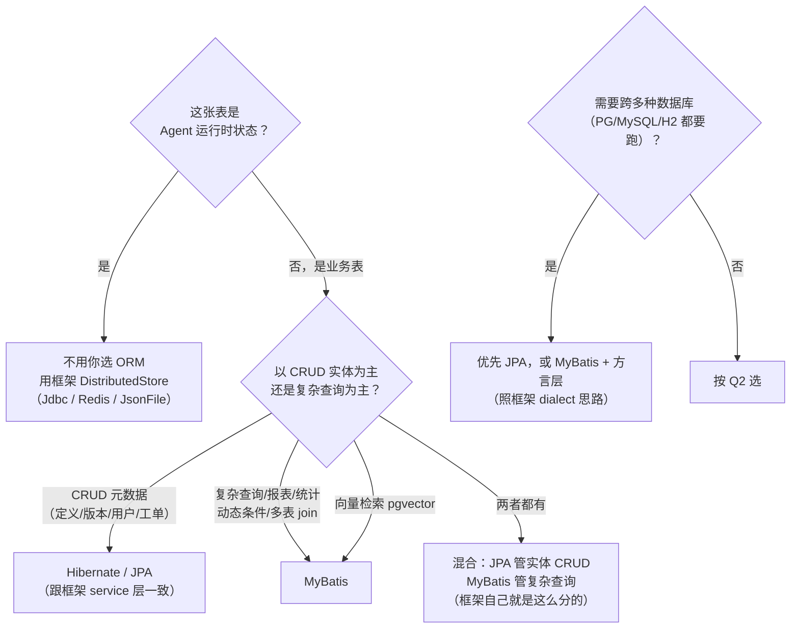
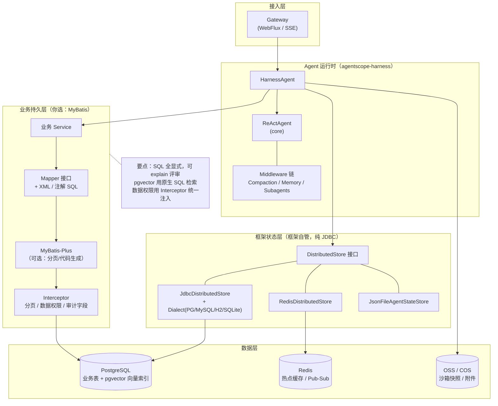
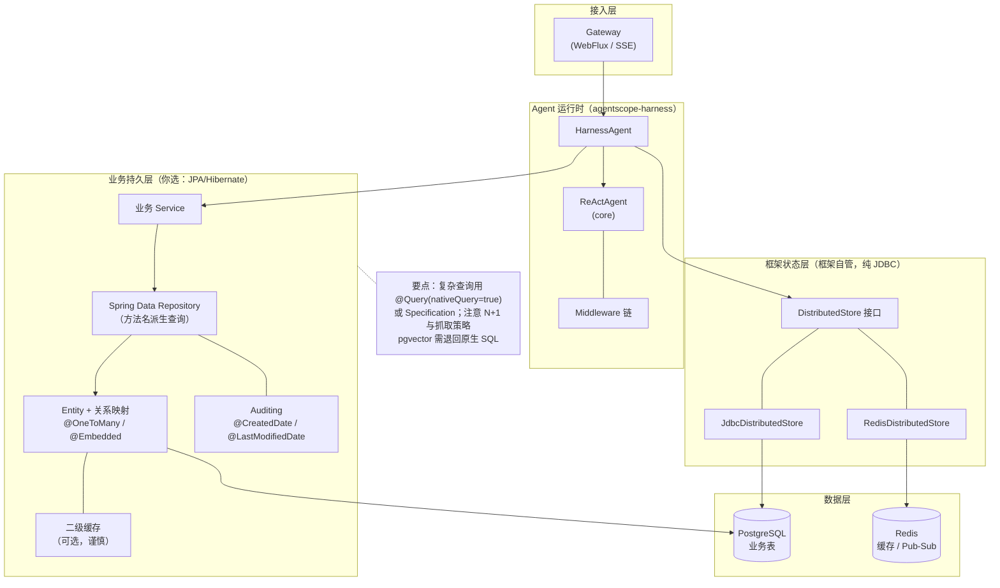

# 09 · 持久层选型：MyBatis 还是 Hibernate（AgentScope Java 场景）

> **TL;DR**
> - **先看框架已经替你选了什么**：AgentScope Java 自身**不用 MyBatis**（全仓零命中），而是双轨制——**框架状态层用纯 JDBC**（`agentscope-extensions-jdbc`，四种方言 + `TableSchemaValidator`），**Service 平台层用 JPA/Hibernate**（`service-common/.../web/persistence/jpa/`，20+ 个 `*EntityRepository`）。
> - **结论**：**业务元数据层跟框架走 JPA；复杂查询/报表/向量检索/动态 SQL 用 MyBatis；两者混合是框架自己示范的姿势**。不要为了"统一"把某一类硬塞给不合适的工具。
> - **你真正要选的其实很少**：Agent 运行时状态（`AgentState`/`SessionLog`）由 `DistributedStore` 接口管理，默认 JSON 文件、生产用 `JdbcDistributedStore` / `RedisDistributedStore`，**都不需要你选 ORM**。要选的只是你自己的业务表。
> - **两个必须注意的坑**：① dataplane 是 WebFlux（响应式）但 JPA 是阻塞的——调用必须包 `subscribeOn(Schedulers.boundedElastic())`；② pgvector 向量检索需要原生 SQL，这一块 JPA 表达力不足。
> 架构图见 §4（方案 A：MyBatis）/ §5（方案 B：Hibernate/JPA），可直接嵌入 md 或用 archify 生成交互版（§8）。

---

## 1. 先看事实：AgentScope Java 自己怎么做的

这不是偏好问题，而是**框架已经给出的参考答案**。基于源码核查（commit `2c6d0eb0`）：

| 层 | 技术 | 证据 | 为什么这么选 |
|---|---|---|---|
| **框架状态层**<br/>（AgentState / SessionLog / Skill / 沙箱租约） | **纯 JDBC**<br/>（无 ORM） | `agentscope-extensions-jdbc/.../jdbc/store/JdbcStore.java`、`dialect/vendor/{Postgres,Mysql,H2,Sqlite}Dialect.java`、`dialect/TableSchemaValidator.java` | ① 要跨 4 种数据库（PG/MySQL/H2/SQLite），方言自己控制；② 热点路径（每次事件都写），不能有 ORM 的额外开销与意外 SQL；③ SQL 可预测、可 DBA 评审 |
| **Service 平台层**<br/>（Agent 定义/版本/用户/分享/HITL 工单） | **JPA / Hibernate** | `spring-boot-starter-data-jpa`（`service-dataplane/pom.xml`）；`service-common/.../web/persistence/jpa/` 下 20+ 个 `*EntityRepository` + `*Entity` | 典型 CRUD 元数据管理，实体关系清晰，Spring Data 生态直接受益 |
| **MyBatis** | **未使用** | 全仓 `grep -ril mybatis` 零命中 | — |
| **R2DBC** | **未使用** | 无 r2dbc 依赖 | 虽然用 WebFlux，持久化仍是阻塞 JDBC（见 §6 的坑） |

**可直接借鉴的三条**：
1. **热点路径（每事件都写）不要用 ORM**——框架宁可手写 JDBC + 方言层。
2. **外围 CRUD 用 JPA**——不跟趋势较劲，Spring Data 真香。
3. **Schema 要可校验**——框架有 `TableSchemaValidator` + `*Dialect`， ORM 的自动 DDL 在金融场景不够（需要显式 migration + 校验）。

---

## 2. 对比表（12 维）

| 维度 | MyBatis (3.5+ / MyBatis-Plus) | Hibernate / Spring Data JPA |
|---|---|---|
| **SQL 控制权** | ✅ 完全在手，SQL 即文档 | ⚠️ 框架生成，复杂时得 `@Query` 原生或 `Criteria` |
| **CRUD 开发速度** | ⚠️ 要写 XML/注解 SQL | ✅ Repository + 方法名派生，最快 |
| **动态查询** | ✅ `<if>/<foreach>/<choose>` 一等公民 | ⚠️ Specification/Criteria API 啰嗦，或退回原生 |
| **复杂 SQL / 报表 / 多表 join** | ✅ 原生强项 | ⚠️ 表达力差，易产生 N+1 与笛卡尔积 |
| **向量检索（pgvector）** | ✅ 原生 SQL `ORDER BY embedding <=> ?` | ⚠️ 需 `@Query(nativeQuery=true)`，基本退回原生 |
| **多数据源 / 分库分表** | ✅ 插件生态成熟（ShardingSphere 等） | ⚠️ 支持弱 |
| **跨数据库可移植性** | ⚠️ SQL 要按方言维护 | ✅ 方言抽象较好（H2/PG/MySQL 都能跑） |
| **缓存** | ⚠️ 一级缓存弱，通常配 Redis/Caffeine | ✅ 一级/二级缓存内建（但调优是坑） |
| **DBA 协作 / 执行计划评审** | ✅ SQL 显式，可直接 explain | ⚠️ 生成的 SQL 要抓日志才能审 |
| **学习曲线** | 低（会 SQL 就会） | 中高（生命周期、脏检查、抓取策略、缓存） |
| **与 Spring 生态一致性** | ✅ starter 成熟 | ✅ 最原生 |
| **团队/金融场景偏好** | ✅ 金融/阿里系常用（《阿里巴巴 Java 开发手册》生态） | ✅ 互联网/Spring 系常用 |

---

## 3. 决策树



---

## 4. 方案 A：MyBatis 架构图

适用：复杂查询为主、需要 SQL 可控、pgvector 检索、多数据源。



**关键设计点**：
- **Agent 状态与业务数据分离**：`AgentState`/`SessionLog` 走框架的 `DistributedStore`（纯 JDBC），业务表走 MyBatis——两条链路互不干扰，热点路径不被 ORM 拖累。
- **Interceptor 做横切**：分页、数据权限（租户隔离）、审计字段（创建人/时间）、SQL 耗时日志都在拦截器层统一做，不散落业务代码。
- **pgvector**：`CREATE INDEX ... USING ivfflat (embedding vector_cosine_ops)` + Mapper 里原生 SQL 检索，JPA 难以自然表达。

---

## 5. 方案 B：Hibernate / JPA 架构图

适用：CRUD 元数据为主、要最快开发、与框架 service 层保持一致。



**关键设计点**：
- **与框架一致**：`service-common` 就是这么做的（20+ Repository），团队只学一套持久化风格。
- **横切用 Spring 机制**：审计用 `@EnableJpaAuditing`，多租户用 `@Filter`/Hibernate 6 的 `@TenantId`，软删除用 `@SQLDelete`。
- **必须防的两个坑**：① N+1（用 `@EntityGraph` 或 `JOIN FETCH`）；② 二级缓存（金融场景数据一致性要求高，**建议默认关闭**，用 Redis 显式缓存更可控）。

---

## 6. 与 AgentScope Java 集成的四个注意点

### 6.1 WebFlux + 阻塞持久化的冲突（最容易踩）

dataplane 用 `spring-boot-starter-webflux`，但 JPA/MyBatis/JDBC **都是阻塞的**。在响应式链里直接调用会阻塞事件循环线程。

```java
// 错误：阻塞了 Reactor 事件循环
public Mono<Result> handle(Request r) {
    return Mono.fromCallable(() -> jpaRepository.findById(r.id()))  // 阻塞！
            .subscribeOn(Schedulers.boundedElastic());               // 必须包这一层
}
```

框架自己也这么处理——`SessionLog` 是阻塞 SPI，注释明写 "runtime integration schedules it on boundedElastic"（`HarnessContextBuilder.java:153`）。**你的业务持久化调用同样必须 `subscribeOn(Schedulers.boundedElastic())`**，并监控该池的队列深度（见 [02 §10.1](02-AgentScope-Java-源码原理.md)）。

### 6.2 Agent 状态不需要你选 ORM

`AgentState` / `SessionLog` / Skill / 沙箱租约的持久化由 `DistributedStore` 一站式接口管理：

```java
HarnessAgent.builder()
    .distributedStore(new JdbcDistributedStore(dataSource))   // 或 Redis / Mongo / OSS / COS
    // 框架自己用 JDBC 实现，不经过你的 ORM
```

**这意味着选型讨论只针对你的业务表**——把这一点先讲清楚，能避免团队在错误的地方吵架。

### 6.3 pgvector 是 JPA 的弱项

若走 [02 §5.5](02-AgentScope-Java-源码原理.md) 的 RAG 路线 A（pgvector 自建），向量检索的 SQL 是：

```sql
SELECT id, content, 1 - (embedding <=> %s) AS score
FROM doc_chunk
WHERE tenant_id = %s
ORDER BY embedding <=> %s
LIMIT %s;
```

MyBatis 里这是一行注解；JPA 里要 `@Query(nativeQuery = true)` 且返回投影要手工处理。**重度向量检索场景，这一点足以决定性倒向 MyBatis**。

### 6.4 金融合规：Schema 要显式管理

框架的 `TableSchemaValidator` + `*Dialect` 提示了一个金融场景的硬要求：**不要依赖 ORM 的 `ddl-auto`**。生产 schema 必须显式 migration（Flyway/Liquibase）+ 启动校验。这一点两种方案都要做，与选哪个 ORM 无关。

---

## 7. 混合策略（推荐）

框架自己已经示范了最优解，直接照抄：

```
┌─ 热点路径（每次事件都写）：框架 JdbcDistributedStore（纯 JDBC + 方言）
├─ 业务实体 CRUD：Spring Data JPA（与 service-common 一致）
└─ 复杂查询 / 报表 / pgvector：MyBatis Mapper（与 JPA 共用同一 DataSource）
```

**落地要点**：
1. **共用一个 `DataSource`**，不要两套连接池（否则事务边界混乱）。
2. **事务统一用 Spring `@Transactional`**——MyBatis 与 JPA 都在同一个事务管理器下（`DataSourceTransactionManager` 或 `JpaTransactionManager` 二选一，别混用）。
3. **表归属清晰**：JPA 实体表让 JPA 管，报表/统计表让 MyBatis 管，**同一张表不要两边都写**（缓存失效与脏检查会打架）。
4. **迁移脚本统一 Flyway**，JPA 侧关掉 `ddl-auto`（设 `none`）。

---

## 8. 用 archify 画架构图

### 8.1 archify 是什么

[tt-a1i/archify](https://github.com/tt-a1i/archify)（MIT，70k+ stars）是一个 **agent skill**：给 Cursor / Claude Code / Codex CLI 这类编码 agent 装上后，让它把代码库或一句话描述转成**自包含的交互式 HTML 架构图**（动画、可探索、可导出），并且**每个框都带 git 引用，渲染器会对照真实提交的代码校验**——图会说谎，archify 让图"像代码一样失败"。

本文 §4/§5 已给出等价的 Mermaid 图（GitHub 与 archify 都直接渲染 Mermaid，可立即用）。若想要 archify 的交互版 + 引用校验，按下面操作。

### 8.2 安装（在 Cursor / Claude Code 中）

```bash
# 方式一：作为 skill 安装到项目
npx skills add tt-a1i/archify        # 或按其 README 的安装方式

# 方式二：直接在 agent 会话里要求
# "Use the archify skill to draw ..."
```

### 8.3 可直接喂给 archify 的 prompt

> Draw two architecture diagrams comparing **MyBatis** vs **Hibernate/JPA** as the business persistence layer for an **AgentScope Java** application.
>
> Both diagrams must contain these layers, top to bottom:
> 1. Access layer: Gateway (Spring WebFlux, SSE / AG-UI events)
> 2. Agent runtime: `HarnessAgent` (composes `ReActAgent`), Middleware chain (Compaction / Memory / Subagents)
> 3. Framework state layer: `DistributedStore` interface with `JdbcDistributedStore` (+ dialect layer for PostgreSQL/MySQL/H2/SQLite) and `RedisDistributedStore` — this layer is pure JDBC, owned by the framework, **not** by the chosen ORM
> 4. Business persistence layer — **the only difference between the two diagrams**:
>    - Diagram A (MyBatis): Service → Mapper interface + XML/annotation SQL → MyBatis-Plus → Interceptor (pagination / data-permission / audit fields) → PostgreSQL (business tables + pgvector index) + Redis + OSS/COS
>    - Diagram B (JPA): Service → Spring Data Repository → Entity/relations + Auditing + optional L2 cache → PostgreSQL + Redis
> 5. Data layer: PostgreSQL, Redis, OSS/COS
>
> Requirements: pin every box to a real file path in `agentscope-java` where applicable (e.g. `agentscope-harness/src/main/java/io/agentscope/harness/agent/HarnessAgent.java`, `agentscope-extensions-jdbc/.../jdbc/JdbcDistributedStore.java`, `agentscope-service/service-common/.../web/persistence/jpa/`), annotate the WebFlux-blocking-JDBC pitfall, and add a note that AgentState/SessionLog persistence is owned by the framework's DistributedStore and does not depend on the ORM choice.

### 8.4 校验提示

archify 的"证据门"会核对每个框的 git 引用。若某框引用不到文件（例如你本地 checkout 的 commit 与文档基线不同），它会报错——**这正是它的价值**：图错了会失败，而不是悄悄骗人。若校验失败，先确认 commit 是否与本文基线一致（`2c6d0eb0`）。

---

## 9. 结论

| 你的情况 | 选什么 |
|---|---|
| 复用 `agentscope-service` 做平台 | **跟框架走 JPA**（它已经用了），复杂查询单独引 MyBatis |
| 只用 `agentscope-harness` 自建应用 | **JPA 管业务 CRUD + MyBatis 管复杂查询/报表/pgvector**（混合，框架示范的姿势） |
| 重向量检索（RAG 自建 pgvector） | **倒向 MyBatis**（原生 SQL 是决定性优势） |
| 重报表/统计/多表 join | **MyBatis** |
| 要最快出 CRUD、团队 Spring 系 | **JPA** |
| 金融合规、SQL 要 DBA 评审 | **MyBatis（显式 SQL）**，或至少复杂查询部分用它 |

**一句话**：**框架已经用"热点路径 JDBC + 外围 CRUD JPA"给出了答案；你照这个分层抄，业务层按"实体用 JPA、复杂与向量用 MyBatis"混合，是最省心且与框架最一致的方案。**

---

> 相关：[02 Java 源码原理 §5.5 RAG 实战](02-AgentScope-Java-源码原理.md) · [02 §10.1 并发与容量](02-AgentScope-Java-源码原理.md) · [05 FinXScope 自建路线](05-FinXScope-金融级智能体底座深度研究.md) · [08 调试与实战手册](08-调试与实战手册.md)
