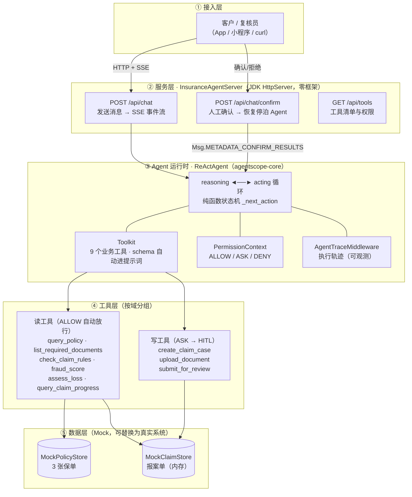
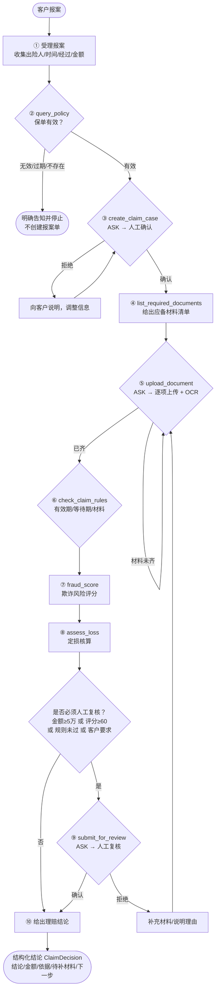
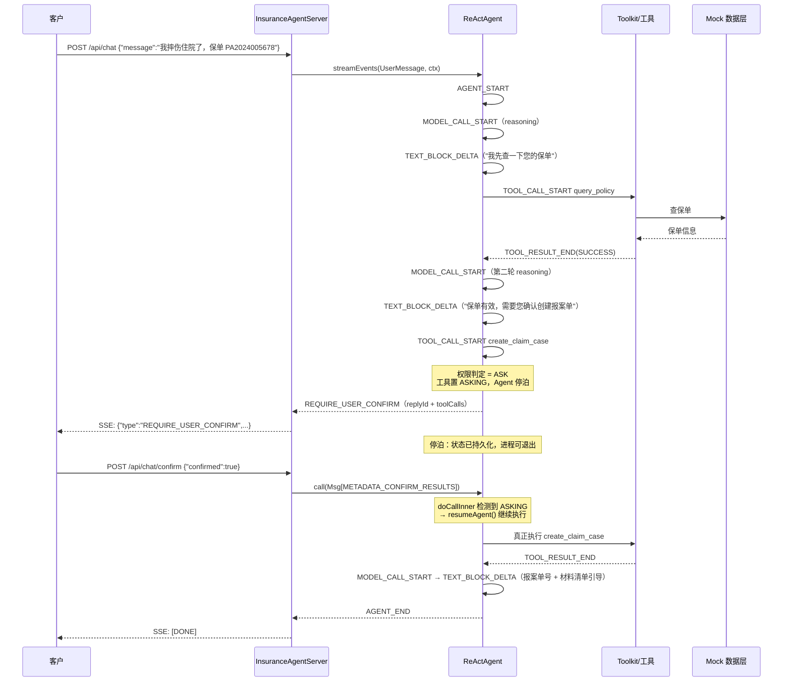
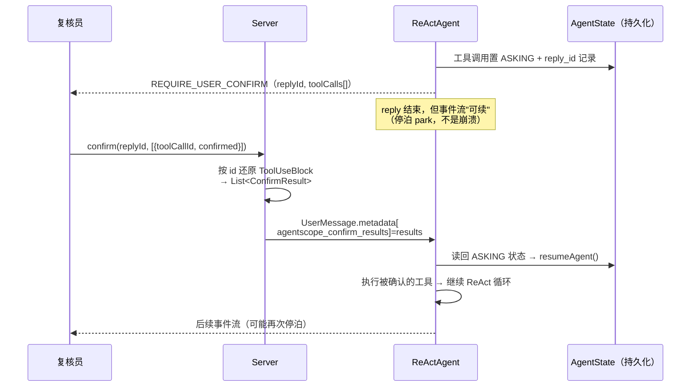

# 10 · insurance-agent：保险理赔智能体 Demo（架构 + 梳理 + 实现）

> **TL;DR**
> - **场景**：保险理赔全流程 —— 受理报案 → 保单核验 → 创建报案单 → 材料收集 → 规则校验 → 欺诈评分 → 定损核算 → 人工复核 → 结论告知。
> - **架构**：`JDK HttpServer（SSE） → ReActAgent（core） → 9 个业务工具（6 ALLOW + 3 ASK） → Mock 数据层`，零 Spring、零 ORM，聚焦 Agent 原理。
> - **演示的五个核心机制**：ReAct 循环、工具调用、**三态权限（ALLOW/ASK/DENY）**、**HITL 停泊-恢复**、结构化输出（`ClaimDecision`）。
> - **代码位置**：`agent_base/insurance-agent/`（Maven，JDK 17，AgentScope Java **2.0.3 GA**，已编译通过）。
> - **与原理文档的对应**：本文每一节都标注了对应的源码机制位置，可作为 [07 培训大纲](07-内部培训大纲-AgentScope深入原理.md) 模块 2/3 的实战教材。

---

## 1. 架构图

### 1.1 总体架构（分层）



### 1.2 理赔主流程（业务流程）



### 1.3 一次正常交互的事件序列（对照 [08 §2.3](08-调试与实战手册.md)）



### 1.4 HITL 停泊-恢复（本 demo 的核心机制）



---

## 2. 设计梳理

### 2.1 场景建模：为什么这样切工具

保险理赔的本质是"**信息收集 + 规则校验 + 风险决策 + 人工背书**"。工具切分遵循两个原则：

1. **一个工具 = 一个可被模型独立理解的原子能力**（不做"大而全的 processClaim"）；
2. **按"读/写"分权**——读操作（查询、校验、评分、核算）自动放行；写操作（建单、上传、提交复核）必须人工确认。

| 域 | 工具 | 读/写 | 权限 | 为什么 |
|---|---|---|---|---|
| 保单 | `query_policy` | 读 | ALLOW | 信息查询，无副作用 |
| 保单 | `list_required_documents` | 读 | ALLOW | 静态知识 |
| 报案 | `create_claim_case` | **写** | **ASK** | 产生正式业务单，需客户确认 |
| 报案 | `query_claim_progress` | 读 | ALLOW | 状态查询 |
| 材料 | `upload_document` | **写** | **ASK** | 上传动作 + 触发 OCR，需确认 |
| 核赔 | `check_claim_rules` | 读 | ALLOW | 规则引擎查询 |
| 核赔 | `fraud_score` | 读 | ALLOW | 风险评分（只读计算） |
| 核赔 | `assess_loss` | 读 | ALLOW | 定损计算（只读） |
| 复核 | `submit_for_review` | **写** | **ASK** | **HITL 主演示点**：进入人工流程 |

> 注意 `assess_loss` / `fraud_score` 是"读"但有业务影响——它们只**计算**不**落库**，真正写结论仍走 `submit_for_review` 的人工确认。这个切分体现了"**计算与决策分离**"：模型可以算，但决策要人背书。

### 2.2 Agent 提示词设计（`InsuranceAgentFactory.SYSTEM_PROMPT`）

提示词是 demo 质量的关键，结构分四块：

1. **角色定位**：理赔助手 Cooper，中文、专业、有同理心；
2. **八步工作流**：显式顺序，并要求"不要跳步、信息不全要追问、不要编造"；
3. **四条硬性规则**：不编造事实、金额日期保单号原样引用、材料不齐不得假装齐、写操作前先说明；
4. **必须转人工的四种情形**：金额 ≥ 5 万、评分 ≥ 60、规则未全过、客户要求。

> 设计意图：把 FinXScope 的"**执行可控 + 过程可追溯**"（[05 §2.2](05-FinXScope-金融级智能体底座深度研究.md)）落到提示词层——**能自动的自动，必须人把关的显式列出**。

### 2.3 权限设计（三态 + fail-closed）

```java
PermissionContextState.builder()
    .mode(PermissionMode.DEFAULT)                    // 未匹配的默认 ASK（fail-closed）
    .addAllowRule("query_policy",      ALLOW)
    .addAllowRule("check_claim_rules", ALLOW)
    ...                                              // 6 个读工具
    .addAskRule("create_claim_case",   ASK)
    .addAskRule("upload_document",     ASK)
    .addAskRule("submit_for_review",   ASK)          // 3 个写工具
    .build();
```

求值顺序（`PermissionEngine.java:30-41`）：`deny → ask → 工具自身检查 → allow → BYPASS → 默认 ASK`。

**为什么用 DEFAULT 而不是 BYPASS**：DEFAULT 下任何**忘记配置的工具都会落到"默认 ASK"**——新增工具时默认是安全的，这是 fail-closed 的工程默认。BYPASS 则相反（新增工具默认放行），只适合受控的演示环境。

### 2.4 HITL 设计（停泊-恢复）

这是本 demo 的技术核心，涉及三个源码机制的配合：

| 机制 | 位置 | 在本 demo 的作用 |
|---|---|---|
| **ASK 权限分支** | `ReActAgent.java:3455` `acting()` 附近 | 工具调用被判为 ASK → 置 `ASKING` 状态 → 发 `RequireUserConfirmEvent` → **return（停泊）** |
| **状态持久化** | `AgentState`（默认状态存储） | ASKING 状态与 `reply_id` 落库，进程重启也能恢复 |
| **恢复入口** | `ReActAgent.java:2170` `doCallInner()` | 再次调用时检测到 ASKING → `validateAndAcceptConfirmResults(msgs, asking)` → `resumeAgent()` |

恢复时确认结果的传递方式（2.0.3 GA API）：

```java
Msg resume = UserMessage.builder()
        .name("reviewer")
        .textContent("（人工复核台已处理上述待确认操作）")
        .metadata(Map.of(Msg.METADATA_CONFIRM_RESULTS,
                List.of(new ConfirmResult(true, toolUseBlock))))
        .build();
agent.streamEvents(List.of(resume), ctx);
```

**Server 端的关键处理**：`RequireUserConfirmEvent` 里带的是 `List<ToolUseBlock>`（含 id/name/input），而客户端回传时只有 id。Server 用 `PENDING_CONFIRMS: Map<replyId, List<ToolUseBlock>>` 缓存停泊时的原始 ToolUseBlock，confirm 时**按 id 还原**——这样保证参数原样传回（`ConfirmResult` 也支持改参数和附带 rules，demo 未用）。

### 2.5 结构化输出设计

`ClaimDecision` 是给业务系统的契约（不是给人看的文本）：

```java
public record ClaimDecision(
        String decision,          // APPROVED / REJECTED / PENDING_REVIEW
        BigDecimal payoutAmount,  // 核定赔付金额
        List<String> reasons,     // 结论依据
        List<String> requiredDocuments, // 待补材料
        String nextStep) {}       // 给用户的下一步引导
```

使用方式（`ReActAgent.java:1105` 的重载）：

```java
Msg result = agent.call(msgs, ClaimDecision.class, ctx).block();
```

> demo 的 HTTP 层目前以事件流为主（便于观察过程）；接业务系统时改用结构化输出重载，直接把 `ClaimDecision` 写入理赔系统，跳过文本解析。这是"**给人看的流 + 给系统用的结构**"双出口设计。

### 2.6 与 FinXScope 能力的对照（本 demo 覆盖了多少）

| FinXScope 能力（[05](05-FinXScope-金融级智能体底座深度研究.md)） | 本 demo | 说明 |
|---|---|---|
| ReAct 循环 | ✅ 直接复用 core | — |
| 工具与技能框架 | ✅ 9 个 `@Tool` | 未用 SKILL.md 三层定义 |
| 三态权限引擎 | ✅ ALLOW/ASK | DENY 规则未配（可按工具加） |
| HITL 人工介入 | ✅ 停泊-恢复 | 单机内存态停泊表，多副本需 Redis |
| 统一消息模型与事件流 | ✅ SSE 推送 | 前端未实现（curl 即可观察） |
| 三层记忆 | ❌ 未做 | 需要 `HarnessAgent` + `MemoryConfig` |
| 意图引擎 | ❌ 未做 | 演示剧本直接给保单号；真实场景需 [05 §4.1](05-FinXScope-金融级智能体底座深度研究.md) 四阶段管道 |
| 用户画像 | ❌ 未做 | — |
| 沙箱执行 | ❌ 未做 | 工具是内存计算，无命令执行 |
| 全链路审计 | ⚠️ 部分 | `AgentTraceMiddleware` + SessionLog；未做业务级审计库 |
| 配置热更新 | ❌ 未做 | — |

> **结论**：本 demo 覆盖了"让 Agent 可信地跑起来"的最小闭环（循环 + 工具 + 权限 + HITL），
> 距离 FinXScope 的"企业级平台"还差**记忆、意图、画像、沙箱、审计、运营**六块——这正是 [05 §10](05-FinXScope-金融级智能体底座深度研究.md) P0→P6 路线的后段。

---

## 3. 工程结构与关键实现

```
insurance-agent/
├── pom.xml                                    # 依赖：harness + dashscope/openai 模型扩展
├── README.md                                  # 运行说明 + 演示剧本
└── src/main/java/io/agentscope/demo/insurance/
    ├── web/InsuranceAgentServer.java          # HttpServer + SSE + /chat + /confirm + /tools
    ├── agent/InsuranceAgentFactory.java       # Agent 装配：工具注册、权限、系统提示词
    ├── domain/                                # Policy / ClaimCase / ClaimDocument / ClaimDecision
    ├── store/                                 # MockPolicyStore / MockClaimStore
    └── tool/                                  # PolicyTools / ClaimTools / DocumentTools /
                                                # AssessmentTools / ReviewTools（9 个 @Tool）
```

### 3.1 关键实现片段

**工具注册（一行接入，schema 自动进提示词）**

```java
Toolkit toolkit = new Toolkit();
toolkit.registerTool(new PolicyTools(policyStore));   // 反射扫描 @Tool 方法
toolkit.registerTool(new ClaimTools(claimStore));
...
```

**SSE 事件推送（`toPayload` 把 32 类事件收敛为前端可用的几种）**

```java
for (AgentEvent event : agent.streamEvents(msg, ctx).toIterable()) {
    if (event instanceof RequireUserConfirmEvent confirm) { /* 停泊分支 */ }
    emit(ex, toPayload(event));   // TEXT_BLOCK_DELTA → text；TOOL_CALL_START → tool；…
}
```

**模型选择（一行切换厂商）**

```java
.model("dashscope:qwen-plus")
// .model("openai:deepseek-chat") / "openai:glm-4.6" / "openai:kimi-k2" / "openai:MiniMax-M2"
```

### 3.2 版本差异（实测发现，值得记录）

| 项 | GA `2.0.3`（demo 使用） | 本地 SNAPSHOT `2c6d0eb0` |
|---|---|---|
| `ConfirmResult` 构造器 | 仅 `(boolean, ToolUseBlock)` 与 `(boolean, ToolUseBlock, rules)` | 额外支持 4 参 `(…, String reason)`，拒绝原因可回喂模型 |
| 影响 | demo 无法传自定义拒绝理由 | 升级后可在 `InsuranceAgentServer` 启用 |

> 这也是 [01/02 文档强调"锚定 commit"](README.md)的原因：**同一套 API 在不同版本间有差异**，行号与签名都要锚定。

---

## 4. 运行与演示

```bash
export JAVA_HOME=/usr/lib/jvm/java-17-openjdk-amd64
export DASHSCOPE_API_KEY=sk-xxx
cd agent_base/insurance-agent
mvn -q clean package -DskipTests
java -jar target/insurance-agent-1.0.0.jar 8080
```

三个演示剧本（标准理赔 / HITL 确认 / 保单失效）与预期事件流见 [`insurance-agent/README.md`](../insurance-agent/README.md)。

**调试提示**（来自 [08](08-调试与实战手册.md)）：
- 看不到事件？确认用的是 `curl -N`（关缓冲）；
- Agent 不动了？看是否出现 `REQUIRE_USER_CONFIRM` —— 它在等你确认，不是卡死；
- 想看内部请求？在 `InsuranceAgentFactory` 加一个 `on_model_call` 中间件打印 messages。

---

## 5. 局限与演进方向

| 局限 | 原因（demo 取舍） | 演进 |
|---|---|---|
| 无 Spring Boot | 避免与 AgentScope BOM 的 Jackson 版本冲突 | 生产按 [09](09-持久层选型-MyBatis-vs-Hibernate.md) 接入 Spring 生态 |
| Mock 数据内存态 | 聚焦 Agent 原理 | 换真实保单/理赔 API；状态用 `JdbcDistributedStore` |
| 停泊表单机内存 | 同上 | 多副本放 Redis（Java 版的分布式挂起持久化） |
| 无记忆/画像/沙箱 | 用 `ReActAgent` 而非 `HarnessAgent` | 换 `HarnessAgent` + `MemoryConfig` + workspace/沙箱 |
| 无意图引擎 | 演示直接给保单号 | 按 [05 §4.1](05-FinXScope-金融级智能体底座深度研究.md) 建四阶段意图管道 |
| 规则/评分是启发式 | 非真实核赔引擎 | 接真实规则引擎与反欺诈模型 |

---

> 相关：[insurance-agent 源码与运行说明](../insurance-agent/README.md) · [01 Python 源码原理](01-AgentScope-Python-源码原理.md) · [02 Java 源码原理](02-AgentScope-Java-源码原理.md) · [05 FinXScope 金融详解](05-FinXScope-金融级智能体底座深度研究.md) · [08 调试与实战手册](08-调试与实战手册.md)
